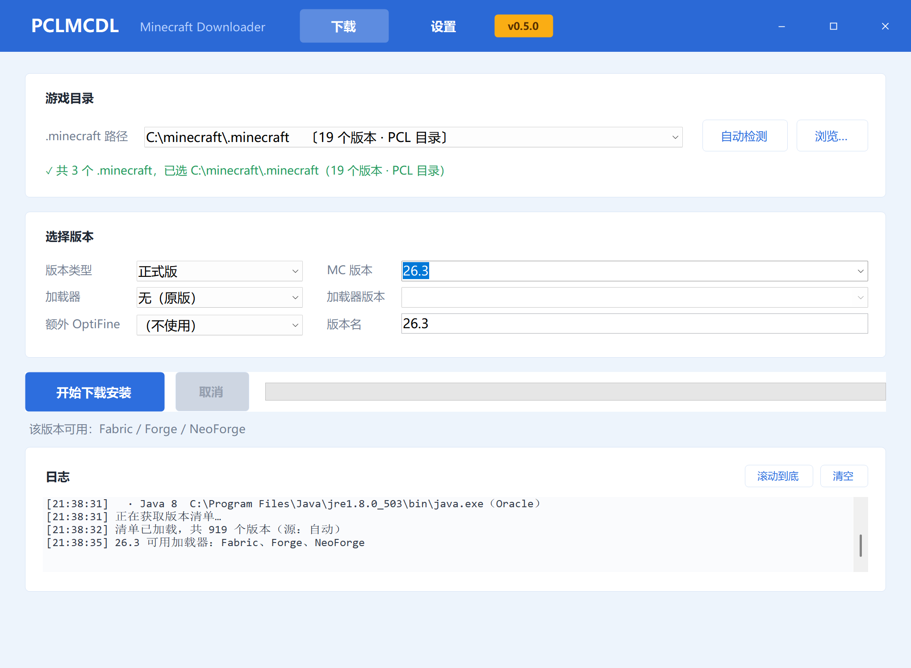

# PCLMCDL

[](https://github.com/gaaibing/PCLMCDL/releases)
[](https://github.com/gaaibing/PCLMCDL/releases)
[](#准备)
[](https://dotnet.microsoft.com/zh-cn/download/dotnet/10.0)

为 PCL 补回下载版本的能力。PCL 自身已无法下载版本，用本工具装好之后，回 PCL 启动即可。



## 下载

| 平台 | 地址 | 说明 |
| --- | --- | --- |
| GitHub | <https://github.com/gaaibing/PCLMCDL/releases> | 主仓库 |
| Gitee | <https://gitee.com/gaaibing/PCLMCDL/releases> | 国内访问更快，内容与 GitHub 同步 |

下载 `PCLMCDL.exe` 即可（约 690 KB，另有源码 zip）。

## 快速开始

1. 装好 .NET 10 桌面运行时（见下方「准备」）
2. 双击 `PCLMCDL.exe`，点「自动检测」；若失败则点「浏览…」，选 **PCL 所在的文件夹**
3. 选 MC 版本和加载器及版本，点「开始下载安装」
4. 装完回到 PCL，在设置中打开版本隔离并选择隔离所有版本，在启动页的版本选择中就能看到新安装的版本

选中 PCL 文件夹后，程序按 `<文件夹>\.minecraft` 自动建好，版本会存在 `.minecraft\versions\`。

## 准备

.NET 10 桌面运行时（.NET Desktop Runtime 10.0.x，Windows x64）。

下载：<https://dotnet.microsoft.com/zh-cn/download/dotnet/10.0>

本程序是框架依赖单文件，约 690 KB，运行时向系统借用，所以要先装好上面的运行时才能启动。

## 特色

- 自动检测 .minecraft 和 Java 路径（也支持检测新安装PCL2时的空目录）；
- 完整支持原版、加载器及 OptiFine 下载安装（LiteLoader 暂不支持）；
- 选定 MC 版本后自动探测可用的加载器（会需要一小会儿），再列出该加载器的版本号；
- 同名版本已存在时弹窗提示，可选「覆盖安装 / 重命名另存 / 取消」。

各加载器的安装方式：

| 类型       | 做法                                                  |
| -------- | --------------------------------------------------- |
| 原版       | 官方 manifest，正式版 / 快照 / old_alpha / old_beta 共 919 个 |
| Fabric   | meta API 合成                                         |
| Forge    | 1.13+ 调官方安装器；1.12.2 及以前走 legacy 解包                  |
| NeoForge | 同 Forge                                             |
| OptiFine | 1.14+ 跑官方安装器；1.13 及以前手写 launchwrapper               |

目录名和 PCL 一致，例如 `1.20.4-Fabric 0.20.1`、`1.20.4-Forge_49.0.9`、`1.12.2-OptiFine_C9`。

## 命令行

```
PCLMCDL.exe install <MC 版本> [选项]

  --loader    vanilla | fabric | forge | neoforge | optifine
  --ver       加载器版本
  --of        OptiFine 补丁号，叠加到其他加载器之上，如 E4
  --dir       .minecraft 或 PCL 目录
  --source    auto | official | mirror
  --workers   并发线程数
  --name      自定义版本名（同名时用来另存一份副本）
  --force     同名时删掉现有版本后覆盖安装

PCLMCDL.exe list     列出前 30 个版本
```

示例：

```
PCLMCDL.exe install 1.20.4
PCLMCDL.exe install 1.20.4 --loader fabric --ver 0.20.1
PCLMCDL.exe install 1.20.4 --loader forge --ver 49.0.9 --of I7
PCLMCDL.exe install 1.4.7
PCLMCDL.exe install 1.21.1 --loader neoforge --ver 21.1.80 --dir "D:\PCL2"
```

## 行为

- `--dir` 严格生效：目录必须已存在，路径不存在则报错退出（退出码 3），**不会**改用其他探测到的实例，避免装错盘；
- 目录存在但缺少 `versions` 时会自动补建；若该目录下已有 `.minecraft`（或 PCL 主程序），versions 则建在 `.minecraft` 里，而不是外层；
- 不传 `--dir` 时按「已装版本数最多」自动挑选；
- Forge / NeoForge / 新版 OptiFine 需要本机 Java 8+，缺失时在下载前报错；原版和 Fabric 不需要 Java。

## 已知限制

- 只负责下载与安装，**不启动游戏**；
- BMCLAPI 对高并发返回 403，预下载已限制到 8 并发并有退避重试；
- OptiFine 官方站有 Cloudflare 保护，只能走 BMCLAPI 镜像；
- 暂不支持 LiteLoader，其数据源停更，官方下载站不可用。

## 署名

本项目参考 PCL 的下载实现思路，并复用其内置的 headless 安装器。

- PCL 作者：龙腾猫跃
- 赞助：<https://afdian.com/a/LTCat>
- 源码：<https://github.com/Meloong-Git/PCL>

PCLMCDL 是第三方作品，与 PCL 官方无关。

通过 WorkBuddy 调用 DeepSeek-v4.1-flash 模型开发，Kimi-K3 审查。
